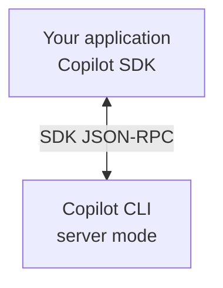
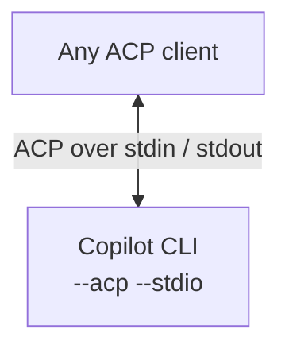
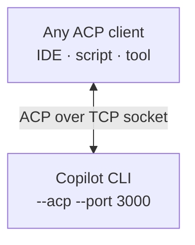

# Copilot SDK vs ACP

## Copilot SDK

SDK manages the child process over a proprietary JSON-RPC protocol.

## ACP · stdio

Client manages the child process over the standard ACP protocol.

## ACP · TCP

Server runs independently. Compatible clients connect with ACP over TCP.

