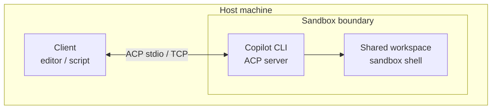

# Execution inside a sandbox

The client stays on the host. **The agent's tools run in the sandbox.**

Share only the workspace the agent needs. Host-side client callbacks and MCP tools need their own controls.

