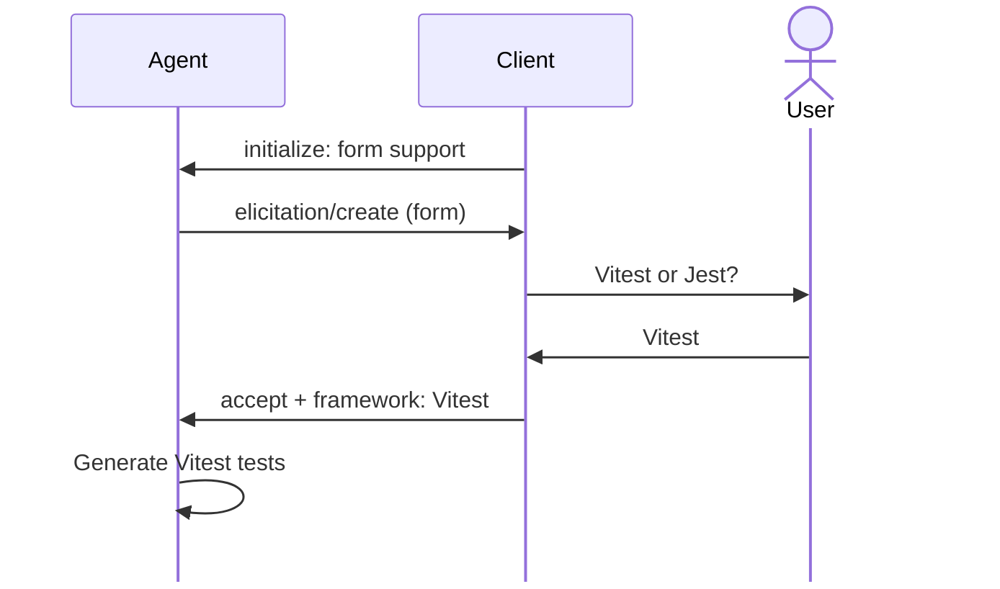

# Extend the harness with elicitation

Example: choose a test framework before generating tests.

<div class="elicitation-columns">
<div>

Advertise form support:

```json
{
  "clientCapabilities": {
    "elicitation": {
      "form": {}
    }
  }
}
```

The client supplies the UI.<br>The agent uses the structured answer.

</div>
<div>



</div>
</div>
